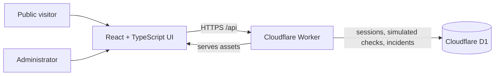

# PulseOps

**An IT operations dashboard and incident-management showcase built with React and Cloudflare.**

[](https://react.dev/)
[](https://www.typescriptlang.org/)
[](https://workers.cloudflare.com/)
[](https://developers.cloudflare.com/d1/)

## Live Demo

**[Explore PulseOps →](https://pulseops.shaddaisec.com)**

The public dashboard can be explored without an account. It shows five fictional services, simulated availability and response times, and simulated incident history. Administrator controls are protected by a login.

> **Simulation only:** PulseOps does not currently monitor websites or make outbound monitoring requests. All demo services, checks, metrics, and incidents are simulated. Historical real-monitoring data, if present, is separate and may be stale.

## What it demonstrates

- A responsive, read-only dashboard with simulated service status, availability charts, response times, and incident history.
- Administrator-only controls to simulate outages, degraded performance, and recovery, with a persistent incident timeline.
- A separate historical real-monitoring overview, analytics, and public status page. Demo data is excluded from real-monitoring metrics.
- Session-based authentication, authorization checks, and D1 migrations for persistent application data.
- A fail-closed monitoring design: creating real endpoints and running live outbound checks are disabled.

## Architecture



The Vite-built React frontend and API are served by one Cloudflare Worker. D1 stores services, checks, incidents, incident events, sessions, and notification status. Version-controlled SQL migrations define the schema and seed the fictional demo. The public demo API returns a fixed set of synthetic services; administration and mutations require a session.

**Stack:** React, TypeScript, Vite, Cloudflare Workers, Cloudflare D1, Wrangler, and Vitest.

## Screenshots

Screenshots are not yet included. The [screenshot guide](docs/screenshots/README.md) describes suggested views and what to review before publishing images. The [live demo](https://pulseops.shaddaisec.com) is available now.

## Run locally

Requirements: Node.js 22.12 or later and npm.

```sh
git clone https://github.com/MPier-IT/pulseops.git
cd pulseops
npm install
npm run db:migrate
cp .dev.vars.example .dev.vars
```

Open `.dev.vars` in a private editor and set `ADMIN_PASSWORD` to your own unique random password of at least 16 characters. Keep the surrounding quotes and do not commit the file. The other example variables are optional and apply only to provider testing.

```sh
npm run dev
```

Open the Vite URL printed in the terminal, usually [http://127.0.0.1:5173](http://127.0.0.1:5173). The Demo Dashboard is public and read-only. Sign in under **Settings** to use the simulation controls. Local D1 state persists in `.wrangler/state`; do not remove it if you need to retain your data.

## Testing

```sh
npm test
npm run typecheck
npm run build
```

The build produces frontend assets and a Wrangler **dry-run** bundle; it does not deploy. Tests cover dashboard rendering, authentication boundaries, public access, incident transitions, the email adapter, and disabled outbound monitoring. The repository also contains `scripts/integration.mjs` for an already-running **local test instance**. It creates demo records, so use a disposable local database; do not run it against the public deployment. Set `PULSEOPS_TEST_PASSWORD` privately to that instance's local test password, then run `node scripts/integration.mjs`.

## API overview

| Endpoint | Access | Purpose |
| --- | --- | --- |
| `GET /api/demo/public` | Public | Fixed simulated showcase data |
| `GET /api/public` | Public | Historical real-monitoring status |
| `GET /api/session` | Public | Current session state |
| `POST /api/login` | Public, rate-limited | Start an administrator session |
| `GET /api/dashboard` | Administrator | Workspace and incident data |
| `POST /api/demo`, `/api/demo/create`, `/api/demo/reset` | Administrator | Simulate status changes or manage the demo |
| `POST /api/logout` | Administrator | Revoke the current session |

State-changing requests require a same-origin `Origin` and `X-PulseOps-Request: 1`. Real endpoint creation is disabled; existing real endpoints can be managed only by an administrator.

## Security and limitations

- Password-based administrator sessions use a random token stored as a hash in D1. On HTTPS, cookies are `Secure`, `HttpOnly`, and `SameSite=Strict`; sessions expire after eight hours and logout revokes them.
- Mutations require an authenticated session, a matching `Origin`, and a custom request header. Login is limited to five attempts per IP per 15-minute window; this does not prevent distributed attacks. There is no built-in MFA.
- The public historical API excludes endpoint URLs, failure reasons, session details, and notification details. Service names, descriptions, and incident titles can be public, so do not store sensitive information in those fields.
- The simulation and real-monitoring datasets are separated. Demo availability is based on synthetic check samples, not a measured SLA. Historical real-check uptime is a proportion of recorded checks, not time-weighted availability.
- The Resend adapter is present, but live email delivery is not configured or verified. Provider acceptance is not proof of mailbox delivery.

### Why outbound monitoring is disabled

Checking a URL or DNS response before a Cloudflare Worker fetch does not pin the address used by the actual connection. DNS rebinding or a redirect can invalidate the earlier check. The scheduled handler is a no-op, no cron trigger is configured, and real endpoint creation is blocked. This is a deliberate restriction, not a claim of complete SSRF protection.

Before enabling real monitoring, an independently enforced egress proxy or equivalent network control should validate and pin destinations, verify TLS against the original hostname, revalidate redirects, block internal and special-use networks, and enforce request limits. The implementation and its network policies need independent security testing. Cloudflare describes Worker hostname resolution and direct-IP limitations in its [Workers known issues](https://developers.cloudflare.com/workers/platform/known-issues/).

## Deployment

The repository's checked-in Wrangler configuration is a template with a placeholder D1 ID. A deployment requires an explicitly selected Cloudflare account, a dedicated D1 database, applied migrations, an appropriate Worker name and asset binding, and an `ADMIN_PASSWORD` stored as a Worker secret. Never commit credentials or reuse an unrelated project's database or configuration.

For a separate installation, review account and resource names, create a dedicated D1 database, and replace the placeholder `database_id` in your own Wrangler configuration. Review the migrations before applying them:

```sh
npx wrangler d1 migrations list pulseops-db --remote
npx wrangler d1 migrations apply pulseops-db --remote
```

Build and deploy only after configuring the account, database, and production secret. Cloudflare supports supplying secrets with a deployment using `wrangler deploy --secrets-file <private-file>`; **that command deploys immediately**. Treat the secret file as private and exclude it from Git. See [Cloudflare's secrets documentation](https://developers.cloudflare.com/workers/configuration/secrets/) and [D1 migration commands](https://developers.cloudflare.com/d1/wrangler-commands/) for details. Recheck the deployed site's public access, administrator authentication, simulation controls, and D1 persistence afterward.

## Roadmap

- Design and independently test a restricted egress service before enabling real HTTP monitoring.
- Add stronger identity integration and MFA, plus improved rate limiting and auditability.
- Introduce durable scheduling and retry handling, alert delivery verification, and notification routing.
- Add time-weighted availability reporting, retention controls, and paginated history.
- Capture and review real screenshots of the simulation for the repository and portfolio.
